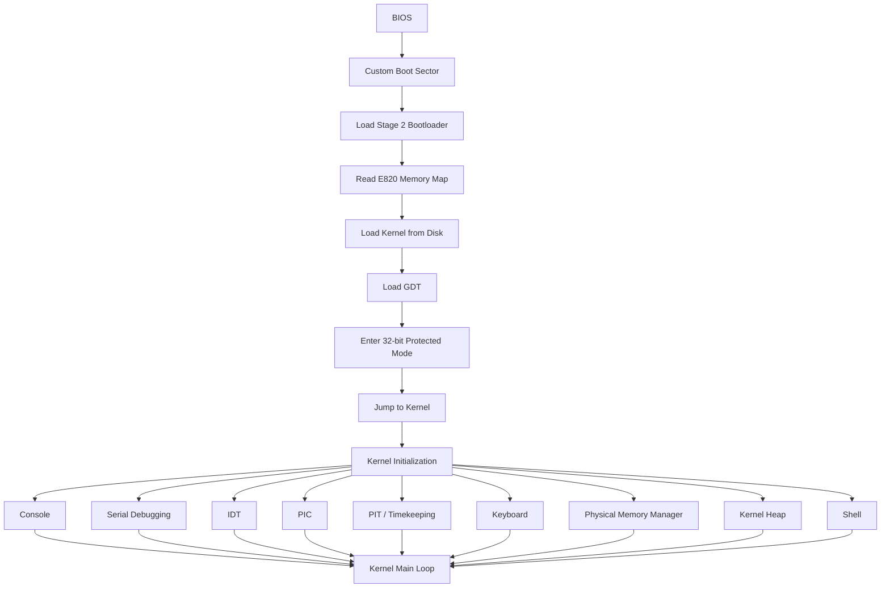
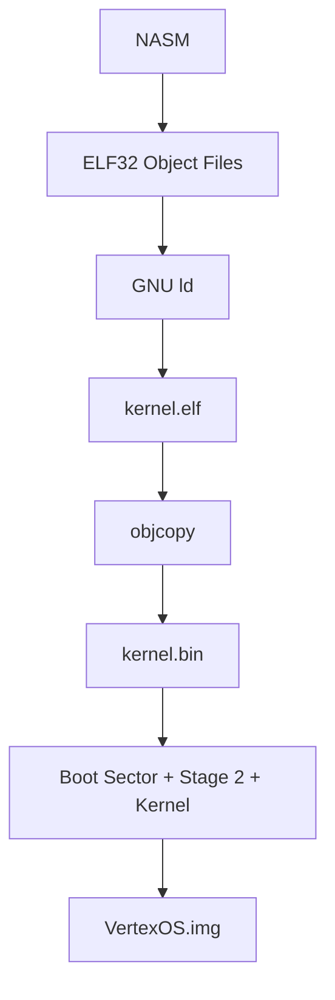

<div align="center">

# 🔷 VertexOS

**A learning-focused operating system built from scratch for 32-bit x86**

-blue)


[Goals](#-project-goals) •
[Status](#-current-status) •
[Architecture](#-architecture) •
[Build](#-building-vertexos) •
[Roadmap](#-roadmap) •
[Limitations](#-current-limitations)

</div>

---

VertexOS is a learning-focused operating system built from scratch for the 32-bit x86 architecture.

The project is being developed incrementally to understand how operating systems work internally, from the boot process and protected mode to interrupts, device drivers, memory management, processes, user mode, filesystems, networking, and eventually a graphical environment.

> VertexOS is primarily an educational and experimental operating system project.

## 📑 Table of Contents

- [Project Goals](#-project-goals)
- [Current Status](#-current-status)
- [Architecture](#-architecture)
- [Development Environment](#-development-environment)
- [Boot Process](#-boot-process)
- [Kernel](#-kernel)
- [Interrupt System](#-interrupt-system)
- [Timer and Timekeeping](#-timer-and-timekeeping)
- [Keyboard Driver](#-keyboard-driver)
- [Console](#-console)
- [Kernel Shell](#-kernel-shell)
- [Physical Memory Manager](#-physical-memory-manager)
- [Kernel Heap](#-kernel-heap)
- [Kernel Panic](#-kernel-panic)
- [Kernel Utility Library](#-kernel-utility-library)
- [Serial Debugging](#-serial-debugging)
- [Memory Layout](#-memory-layout)
- [Build System](#-build-system)
- [Building VertexOS](#-building-vertexos)
- [Project Structure](#-project-structure)
- [Development Philosophy](#-development-philosophy)
- [Roadmap](#-roadmap)
- [Current Limitations](#-current-limitations)
- [License](#-license)

---

## 🎯 Project Goals

The main goal of VertexOS is to understand operating-system internals by implementing its major components step by step rather than relying on an existing kernel or operating-system framework.

The project focuses on understanding:

| | |
|---|---|
| 🔌 How a computer boots | 🧠 How physical memory is managed |
| 🛡️ How the CPU enters protected mode | 📄 How paging and virtual memory work |
| 📦 How a kernel is loaded and executed | ⚙️ How processes and scheduling work |
| ⚡ How interrupts work | 👤 How user programs interact with the kernel |
| 🔧 How hardware devices communicate with the CPU | 💾 How filesystems and storage work |
| 🌐 How networking works at a low level | 🔒 How operating-system security mechanisms are designed |

---

## 📊 Current Status

VertexOS currently boots a custom kernel in 32-bit x86 protected mode and provides a functional kernel environment with hardware interrupt handling, keyboard input, a command shell, timekeeping, physical memory management, a kernel heap, kernel panic handling, and serial debugging.

### ✅ Implemented

<details open>
<summary><b>Boot and CPU</b></summary>

- [x] Custom BIOS bootloader
- [x] BIOS disk access using INT 13h extensions
- [x] x86 protected mode
- [x] Global Descriptor Table (GDT)
- [x] 32-bit kernel
- [x] Interrupt Descriptor Table (IDT)
- [x] Programmable Interrupt Controller (PIC)
- [x] CPU exception handling

</details>

<details open>
<summary><b>Console and Input</b></summary>

- [x] VGA text-mode console
- [x] Console cursor management
- [x] Screen scrolling
- [x] Keyboard driver
- [x] Shift and Caps Lock handling
- [x] Physical Caps Lock LED synchronization
- [x] Interactive kernel shell

</details>

<details open>
<summary><b>Time and Kernel Services</b></summary>

- [x] Programmable Interval Timer (PIT)
- [x] Kernel tick counter
- [x] Kernel uptime
- [x] Kernel timekeeping interface
- [x] Kernel utility library
  - String operations
  - Memory operations
  - Number conversion utilities
- [x] Kernel panic system
- [x] COM1 serial debugging

</details>

<details open>
<summary><b>Memory</b></summary>

- [x] Physical memory manager (PMM)
- [x] E820 memory-map processing
- [x] Physical page allocation and freeing
- [x] Physical memory usage statistics
- [x] Kernel heap

</details>

<details open>
<summary><b>Build and Testing</b></summary>

- [x] Kernel image size validation
- [x] Boot image validation
- [x] Automated kernel-sector boundary tests
- [x] QEMU-based development and testing

</details>

### 🚧 Currently Being Developed

- [ ] Paging
- [ ] Virtual memory
- [ ] Improved memory diagnostics
- [ ] Storage subsystem
- [ ] Process management
- [ ] Scheduler
- [ ] User mode

### 🗺️ Planned

- [ ] ATA/disk driver
- [ ] Filesystem
- [ ] Virtual File System (VFS)
- [ ] Improved shell
- [ ] System calls
- [ ] User programs
- [ ] Inter-process communication
- [ ] Hardware abstraction
- [ ] Networking
- [ ] Security mechanisms
- [ ] Graphical interface

---

## 🏗️ Architecture

### Target Architecture

| Component | Details |
|---|---|
| **CPU architecture** | x86 |
| **Kernel mode** | 32-bit protected mode |
| **Kernel type** | Custom experimental kernel |
| **Boot method** | BIOS |
| **Bootloader** | Custom bootloader |
| **Console** | VGA text mode |
| **Interrupt controller** | 8259 PIC |
| **Timer** | Intel 8253/8254-compatible PIT |
| **Keyboard interface** | PS/2 |
| **Serial interface** | COM1 UART |
| **Emulator** | QEMU |

---

## 🛠️ Development Environment

VertexOS is currently developed inside Ubuntu running through WSL2.

| Tool | Purpose |
|---|---|
| `NASM` | Assembler |
| `GNU ld` | Linker |
| `GNU objcopy` | ELF to flat binary conversion |
| `GNU Make` | Build system |
| `GNU binutils` | Binary utilities |
| `Git` | Version control |
| `QEMU` | Emulator |
| `Ubuntu on WSL2` | Development environment |

---

## 🚀 Boot Process

The current boot process is intentionally implemented from scratch.



The bootloader currently loads the kernel from disk into memory at:

```text
0x1000
```

The E820 memory map is passed to the kernel during the protected-mode handoff.

---

## 🧩 Kernel

The VertexOS kernel is currently implemented primarily in x86 assembly.

The kernel is linked to execute at:

```text
0x1000
```

The kernel binary is converted from ELF to a flat binary image and then combined with the boot sector and stage 2 bootloader to create the final disk image.

The build system calculates the number of sectors required by the kernel and validates the kernel size against the bootloader's loading limit.

---

## ⚡ Interrupt System

VertexOS currently contains an interrupt subsystem based on the x86 Interrupt Descriptor Table.

Implemented interrupt components include:

- Interrupt Descriptor Table (IDT)
- Interrupt handlers
- Programmable Interrupt Controller (PIC)
- Hardware IRQ handling
- CPU exception handling

The PIC is remapped so that hardware IRQs do not conflict with CPU exception vectors.

### Hardware Interrupt Mapping

| IRQ | Vector | Device |
|---|---|---|
| IRQ0 | `0x20` | Timer |
| IRQ1 | `0x21` | Keyboard |

### CPU Exceptions

VertexOS contains handlers for CPU exceptions.

Exception information can include:

- Exception name
- Interrupt vector
- Error code
- Instruction pointer (EIP)
- Code segment (CS)
- EFLAGS

For example, a divide-by-zero exception can be detected and reported by the kernel before halting the system.

---

## ⏱️ Timer and Timekeeping

VertexOS uses the Programmable Interval Timer (PIT) to generate periodic timer interrupts.

The current timer frequency is approximately **100 Hz**.

The kernel maintains a global tick counter.

The shell currently provides `ticks` and `uptime`. These commands allow the kernel timer and basic timekeeping system to be tested interactively.

---

## ⌨️ Keyboard Driver

VertexOS includes a PS/2 keyboard driver.

Current features include:

- Keyboard interrupt handling
- Character input
- Shift key support
- Caps Lock
- Backspace
- Enter
- Input buffering
- Maximum input length protection
- Shell prompt protection
- Caps Lock LED synchronization
- Asynchronous keyboard LED command handling
- Keyboard command timeout and recovery

The keyboard driver communicates directly with the PS/2 controller ports.

---

## 🖥️ Console

VertexOS currently uses VGA text mode for its console.

The console subsystem provides:

- Character output
- String output
- New lines
- Cursor management
- Cursor drawing/removal
- Backspace support
- Screen scrolling
- Screen-boundary protection
- Console clearing

The VGA text buffer is located at `0xB8000` with a standard `80 x 25` text-mode display.

---

## 💻 Kernel Shell

VertexOS currently contains an interactive kernel shell.

| Command | Description |
|---|---|
| `help` | Display available commands |
| `about` | Display information about VertexOS |
| `version` | Display the kernel version |
| `info` | Display system information |
| `clear` | Clear the console |
| `ticks` | Display the kernel tick counter |
| `uptime` | Display kernel uptime |
| `echo` | Print supplied text |
| `mem` | Display physical memory statistics |
| `panic` | Trigger a manual kernel panic |

The `mem` command currently displays:

- Total usable physical pages
- Free physical pages
- Allocated physical pages
- Free physical memory in KiB
- Memory usage percentage

> The shell operates directly inside the kernel and is currently not a user-space program.

---

## 🧠 Physical Memory Manager

VertexOS contains a physical memory manager (PMM) that processes the BIOS E820 memory map.

The PMM currently supports:

- Detecting usable physical memory
- Tracking usable physical pages
- Reserving unavailable memory regions
- Reserving kernel and boot-related memory
- Allocating physical pages
- Freeing physical pages
- Tracking free and total usable pages
- Reporting physical memory usage

The PMM uses a bitmap-based page allocation system.

> The current implementation manages physical memory within a configured maximum address range. Paging and virtual memory are planned as separate future milestones.

---

## 📦 Kernel Heap

VertexOS includes a kernel heap subsystem for dynamic kernel memory allocation.

The heap is currently part of the kernel's memory-management foundation. Its capabilities will evolve as paging and virtual memory are introduced.

---

## 🚨 Kernel Panic

VertexOS contains a kernel panic subsystem for unrecoverable conditions and manual testing.

The panic system:

1. Disables interrupts
2. Displays a panic header
3. Displays the panic reason
4. Displays a halted-system message
5. Permanently halts the CPU

Example:

```text
==================================================
                  KERNEL PANIC
==================================================
Reason: Manual panic test
System halted.
```

---

## 📚 Kernel Utility Library

VertexOS contains a small kernel utility library.

| Category | Functions |
|---|---|
| **String and memory** | `strlen`, `strcmp`, `memset`, `memcpy`, `memcmp`, `memmove` |
| **Number conversion** | `itoa`, `itoa_hex` |

These utilities will become increasingly important as the kernel grows.

---

## 🔌 Serial Debugging

VertexOS includes a COM1 serial debugging driver.

The serial subsystem currently supports:

- `serial_init`
- `serial_write`
- `serial_print`
- `serial_write_hex`

COM1 is configured for:

| Setting | Value |
|---|---|
| Baud rate | 38400 |
| Data bits | 8 |
| Stop bits | 1 |
| Parity | None |

Serial output can be captured through QEMU.

Example:

```text
[SERIAL] COM1 initialized. Test value: 0x1234ABCD
```

Serial debugging will be used extensively as VertexOS becomes more complex, especially during memory management, paging, interrupt, and process development.

---

## 🗺️ Memory Layout

| Region | Address |
|---|---|
| Kernel load address | `0x1000` |
| VGA text buffer | `0xB8000` |
| Initial kernel stack | `0x90000` |

The bootloader uses a protected-mode GDT and establishes a kernel stack before transferring control to the kernel.

The physical memory manager uses the E820 memory map to identify usable and reserved regions.

> The memory layout will evolve significantly when paging and virtual memory are introduced.

---

## 🔨 Build System

VertexOS uses GNU Make to assemble, link, and build the final disk image.



The build system also performs image validation and automated kernel-sector boundary tests.

---

## ▶️ Building VertexOS

**1. Clone the repository and enter the project**

```bash
git clone https://github.com/Indra9555/VertexOS.git
cd VertexOS
```

**2. Build the operating system**

```bash
make
```

**3. Run it using QEMU**

```bash
make run
```

**4. Run build and image validation checks**

```bash
make check
```

**5. Clean generated build files**

```bash
make clean
```

---

## 📁 Project Structure

<details>
<summary><b>Click to expand</b></summary>

```text
VertexOS/
|
├── boot/
│   ├── boot.asm
│   └── stage2.asm
|
├── kernel/
│   ├── kernel.asm
│   │
│   ├── console/
│   │   └── console.asm
│   │
│   ├── drivers/
│   │   ├── keyboard.asm
│   │   └── serial.asm
│   │
│   ├── interrupts/
│   │   ├── idt.asm
│   │   ├── pic.asm
│   │   ├── timer.asm
│   │   └── exceptions.asm
│   │
│   ├── lib/
│   │   ├── string.asm
│   │   └── number.asm
│   │
│   ├── memory/
│   │   ├── pmm.asm
│   │   └── heap.asm
│   │
│   ├── panic/
│   │   └── panic.asm
│   │
│   ├── shell/
│   │   └── shell.asm
│   │
│   ├── time/
│   │   └── time.asm
│   │
│   ├── include/
│   │   ├── string.inc
│   │   └── number.inc
│   │
│   └── linker.ld
│
├── tests/
│   └── test_kernel_sectors.py
│
├── Makefile
└── README.md
```

</details>

---

## 🧭 Development Philosophy

VertexOS is intentionally being developed incrementally.

Each subsystem is implemented, tested, and verified before moving to the next major subsystem.

The development process generally follows:


> The goal is not simply to produce a bootable operating system, but to understand why each component exists and how the components interact.

---

## 🛣️ Roadmap

| Phase | Name | Items |
|:---:|---|---|
| **0** | Foundation | Project structure • Build system • Git repository • Custom bootloader • QEMU boot testing |
| **1** | Kernel Core | Protected mode • GDT • Kernel entry point • VGA console • IDT • PIC • CPU exceptions • Keyboard driver • Kernel shell |
| **2** | Kernel Services | PIT timer • Kernel tick counter • Timekeeping • Kernel utility library • Kernel panic system • Serial debugging |
| **3** | Memory Management | E820 memory map processing • Physical memory manager • Physical page allocation and freeing • Kernel heap • Paging • Virtual memory |
| **4** | Storage | Disk driver • ATA support • Block device layer • Filesystem • Virtual File System |
| **5** | Processes | Process abstraction • Kernel task management • Context switching • Scheduler • User mode |
| **6** | System Interface | System calls • User programs • Process isolation • Inter-process communication |
| **7** | Hardware and Networking | Hardware abstraction • Additional device drivers • Network driver • Network stack • Basic networking utilities |
| **8** | User Experience | Advanced shell • User utilities • Graphical interface • Basic desktop environment |
| **9** | Hardening and Tooling | Memory protection • Kernel/user separation • Security mechanisms • Better diagnostics • Kernel debugging tools • Automated kernel-sector boundary testing • Documentation improvements |

---

## ⚠️ Current Limitations

> VertexOS is an experimental educational operating system and is not intended for production use.

Current limitations include:

- ❌ 32-bit protected-mode kernel
- ❌ Limited hardware support
- ❌ No paging or virtual memory yet
- ❌ Limited physical memory management
- ❌ No filesystem
- ❌ No user mode
- ❌ No processes
- ❌ No scheduler
- ❌ No system calls
- ❌ No networking stack
- ❌ No graphical environment

These limitations are expected and will be addressed progressively as development continues.

---

## 📜 License

License: To be decided.
